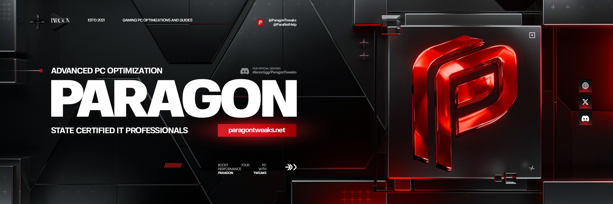
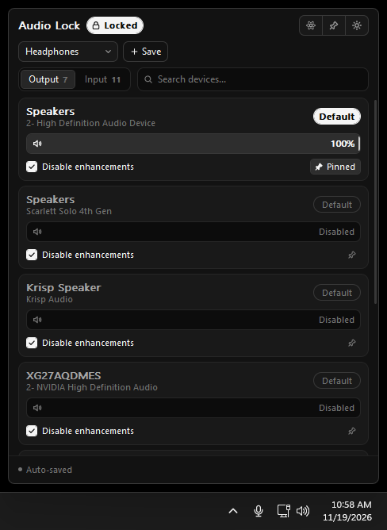
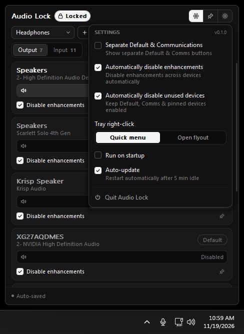
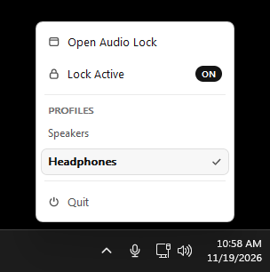

<a href="https://paragontweaks.net"></a>

> Built by **[Paragon Tweaks](https://paragontweaks.net)**. Want full-system FPS, latency, BIOS, and network tuning beyond audio? Check out **[PTU (Paragon Tweaking Utility)](https://paragontweaks.net/utilities)** at https://paragontweaks.net/utilities.

# Audio Lock

[](https://github.com/Paragon-Tweaks/audio-lock/releases/latest)
[](LICENSE)


Keep your Windows speakers and microphone locked where you want them, mute your mic from the taskbar, turn off hidden Windows sound effects, and hot-swap audio profiles in a single ~1.48 MB app that uses 0% CPU while you play.

**[Download Latest Release (`DefaultAudioLock-Setup-<version>.exe`)](https://github.com/Paragon-Tweaks/audio-lock/releases/latest)**

Per-user installer (`%LOCALAPPDATA%\Programs\DefaultAudioLock`). No Admin rights or UAC prompt required.

<table>
  <tr>
    <td align="center" colspan="2">
      <br />
      <sub><strong>Dark Mode</strong></sub>
    </td>
    <td align="center" colspan="2">
      <br />
      <sub><strong>Light Mode</strong></sub>
    </td>
    <td align="center" colspan="2">
      <br />
      <sub><strong>Settings</strong></sub>
    </td>
  </tr>
  <tr>
    <td align="center" colspan="3">
      <br />
      <sub><strong>Quick Menu (Dark)</strong></sub>
    </td>
    <td align="center" colspan="3">
      <br />
      <sub><strong>Quick Menu (Light)</strong></sub>
    </td>
  </tr>
  <tr>
    <td align="center" colspan="3">
      <br />
      <sub><strong>Tray Hover (Mic Live)</strong></sub>
    </td>
    <td align="center" colspan="3">
      <br />
      <sub><strong>Tray Hover (Mic Muted)</strong></sub>
    </td>
  </tr>
</table>

## What It Does

- **Lock your audio defaults**: Stops Windows, game updates, monitor wakes, and USB headsets from randomly hijacking your speakers or mic.
- **One-click mic mute from your taskbar**: White mic outline means live, red inside means muted. Left-click mutes both your Default and Communications mics at once.
- **Hide unused audio devices (optional)**: Turn on the optional Settings toggle (off by default) to automatically disable devices you are not using (while keeping your pinned favorites enabled) so apps like Discord, OBS, or Krisp never grab the wrong mic.
- **Turn off Windows audio enhancements in one click**: Disables hidden Windows sound effects (`SysFx`) and turns off Spatial Sound so they never muddy game audio, with one-click undo that restores your prior Windows audio enhancement (`SysFx`) and Spatial Sound format (Windows Sonic, Dolby Atmos, DTS:X) settings, plus an optional Settings toggle (off by default) to disable them automatically on new devices.
- **Hot-swap audio profiles**: Switch between Gaming, Streaming, Speakers, or Work setups from the flyout or the instant right-click tray menu.
- **Safe "Listen to this device" monitoring**: Hear your mic through any playback device with a searchable dropdown that defaults to `None` so you never blast feedback by accident.
- **Stays out of your way while gaming**: Uses ~1.2 MB of RAM, 0% CPU when idle, and zero GPU memory. Auto-updates silently in the background and only restarts when your PC is genuinely idle for 5 minutes, never interrupting fullscreen games or active controller sessions.

## Measured Performance (`--release`)

| Metric | Measured Result |
| :--- | :--- |
| **Single Executable** | `1.48 MB` (`1,550,848` bytes) |
| **Idle RAM** | `1.23 MB` Working Set (`2.14 MB` Private) |
| **Idle CPU** | `0.000%` (zero polling, pure Win32 message loop + CoreAudio COM callbacks) |
| **Flyout Open** | `6.88 MB` Working Set (`2.49 MB` Private), `~23 ms` open, `0 MB` GPU/VRAM (no D3D11/DXGI loaded) |
| **Priority** | `BelowNormal` + Windows Efficiency Mode (`EcoQoS`) |
| **OS Dependencies** | Zero WebView2, zero .NET, zero Windows Services or Task Scheduler (works on stripped/tweaked Windows builds) |

## Technical Breakdown

- **CoreAudio event locking**: Hooks `IMMNotificationClient` and enforces defaults via `IPolicyConfig` as soon as Windows, a USB hot-plug, or a driver update switches endpoints. Defaults to unified Default + Communications locking, with an optional split Default/Comms toggle in Settings (off by default).
- **Pure-Win32 UI**: Rendered directly to GDI/DIB buffers with ClearType text (no WebView2, no D3D11/DXGI, no GPU context). Includes a monochrome Dark/Light flyout with live search, per-device pinning, and 26 px volume bars, alongside an instant native right-click tray menu.
- **Endpoint and enhancement control**: Optionally disables unused endpoints via Settings (off by default) while keeping Default, Communications, pinned devices, and active Listen targets enabled. Disables Windows audio enhancements (`PKEY_AudioEndpoint_Disable_SysFx`) and turns off Windows Spatial Sound, with one-click undo restoring prior `SysFx` and Spatial Sound format (Windows Sonic, Dolby Atmos, DTS:X) settings, bulk re-enable, and an optional auto-disable toggle in Settings (off by default).
- **Zero-hook silent updater**: Checks GitHub Releases using native `WinHTTP`, validates archives with `BCrypt` SHA-256 verification, and restarts staged updates via `GetLastInputInfo` and `SHQueryUserNotificationState` only when the PC is genuinely idle for 5 minutes, never interrupting fullscreen games or active controller sessions.
- **Local automation IPC**: Exposes a per-user Named Pipe JSON interface (`\\.\pipe\default-audio-lock-ipc`) for Stream Deck, AutoHotkey, PowerShell, PTU, and custom hotkey automation. See [`docs/IPC.md`](docs/IPC.md) for the full protocol reference and copy-paste scripts.
- **Per-user install and startup**: Installs to `%LOCALAPPDATA%\Programs\DefaultAudioLock` and registers optional autostart via `HKCU\...\Run`. Requires no elevation, no Windows Services, and no Task Scheduler entries.

## Building from Source & Releasing

Requires Rust 1.85+ (stable toolchain, `x86_64-pc-windows-msvc`).

```powershell
# Build release binary (target\release\default-audio-lock.exe)
cargo build --release --workspace

# Run tests and lints
cargo test --workspace
cargo clippy --workspace --all-targets -- -D warnings
```

### Local Release Packaging

Packages `dist\default-audio-lock-win64-update.zip`, `dist\manifest.json` (with SHA-256 hash), and `dist\DefaultAudioLock-Setup-<version>.exe` (when Inno Setup 6 is installed):

```powershell
.\scripts\build-release.ps1 -GithubRepo Paragon-Tweaks/audio-lock
```

### Automated GitHub Releases

Pushing a version tag (`v*`) runs [`.github/workflows/release.yml`](.github/workflows/release.yml) to test the workspace, compile with `AUDIO_LOCK_GITHUB_REPO` set for auto-updates, build the Inno Setup installer, and publish the release assets:

```powershell
git tag v0.1.0
git push origin v0.1.0
```

## License

Copyright (c) 2026 Tulantro LLC (Paragon Tweaks) - @TheTulantro @ParagonTweaks.

Licensed under the **GNU General Public License v3.0** (`GPL-3.0-only`). See [LICENSE](LICENSE) for the full text.
